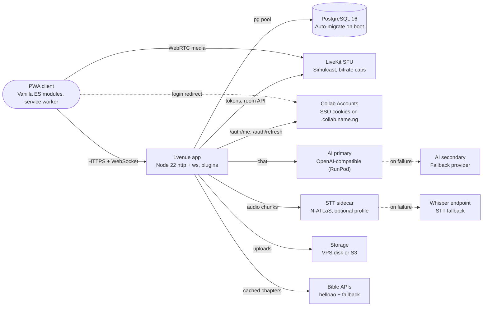

# 1venue blueprint

> What 1venue is, how it is built, what is done versus partial, and what to build next. Grounded in the repo at `oluebubeogb/1venue` as of 23 Oct 2026; statuses are honest and meant to be refined section by section.

## Contents

1. [Vision and positioning](#1-vision-and-positioning)
2. [Architecture](#2-architecture)
3. [Sitemap and navigation](#3-sitemap-and-navigation)
4. [Feature map](#4-feature-map)
5. [Design system](#5-design-system)
6. [Command bar](#6-command-bar)
7. [Data model](#7-data-model)
8. [AI, speech-to-text and Bibles](#8-ai-speech-to-text-and-bibles)
9. [Deployment](#9-deployment)
10. [Gaps and roadmap](#10-gaps-and-roadmap)
11. [Open questions](#open-questions)

## 1. Vision and positioning

| | |
|---|---|
| **What it is** | Premium virtual events and meetings: talk shows, seminars, sermons, presentations and team calls |
| **Lineage** | Evolution of Meet: every Meet feature kept (inventory sections A–H), new UI and venue layer on top |
| **Suite** | Part of Collab, signs in through Collab Accounts SSO |
| **Market** | Nigeria-first: Nigerian-accent and Yoruba, Igbo, Hausa captions, low-bandwidth caps, mobile-first PWA |
| **Differentiators** | Speaker seats with request-to-speak, host-synced scripture, `Name: text` transcripts with AI summaries, social layer |
| **Feel** | Premium and alive: colour-coded function groups, motion, faint background art, Instagram-like stickiness |

## 2. Architecture

If both server STT engines fail, the browser's Web Speech API captures captions client-side. Recordings never leave the user's device. Coolify's proxy sits in front of the app and terminates HTTPS.

## 3. Sitemap and navigation

| Route | Page | Purpose |
|---|---|---|
| `/` | Home | Hero, live now, browse by vibe, coming up |
| `/discover`, `/search` | Discover | Live and upcoming events, categories, search |
| `/e/:slug` | Event | Details, speakers, RSVP, themed QR, comments |
| `/create` | Create | Schedule or go live, speaker seats, AI title |
| `/dashboard` | Dashboard | Hosted, upcoming, sessions, stats |
| `/feed` | Feed | Posts and event activity from people you follow |
| `/me`, `/u/:id` | Profile | Timeline, follows, hosted events |
| `/sessions`, `/session/:id` | Sessions | Transcript, AI summary, downloads |
| `/bible` | Bible | Reader, translations, share a verse |
| `/whiteboard` | Whiteboard | Personal board |
| `/settings` | Settings | Theme, accent, font size, motion, devices, translation |
| `/login` | Login | SSO redirect or local sign-in |
| `/new`, `/ABC-123` | Room | Pre-join, waiting, stage, panels |

### In-room panels

- **Chat**: Everyone, Direct, Groups; attachments and voice notes
- **People**: Hosts, speakers, audience, request queue, moderation actions
- **Engage**: Polls, Q&A, comments
- **Tools**: Scripture, captions, AI, whiteboards, present, timeline, record, breakouts, security, activity, diagnostics, shortcuts

### Mobile vs desktop

- **Desktop**: Top bar (Home, Discover, Feed, Dashboard, Bible, Create) plus footer command bar; room panel docks at 380 px on the right
- **Mobile**: Bottom tab bar (Home, Discover, Create, Feed, Me) with the command bar above it; room panel becomes a bottom sheet at 820 px and below
- **Both**: Every action is also reachable by typing into the command bar

## 4. Feature map

**Totals:** 46 features — Done: 19 · Partial: 24 · Not built: 3

| Group | Feature | Status | Tooltip family | Notes |
|---|---|---|---|---|
| Media | LiveKit audio and video, device picker, mute and camera | Partial | Blue (media) | Built; never run against a real LiveKit server |
| Media | Simulcast, dynacast, adaptive stream, bitrate and fps caps | Partial | Blue (media) | Env-driven (`SIMULCAST`, `VIDEO_MAX_BITRATE`…); untested live |
| Media | Screen share and screen timeline | Partial | Blue (media) | Built; needs LiveKit to verify |
| Media | Grid, spotlight and speaker layouts | Done | Blue (media) | Switching verified in the smoke test |
| Media | Document PiP with video PiP fallback | Partial | Blue (media) | Coded; not tested on a real device |
| Media | Client-side recording (stays on the user's device) | Partial | Blue (media) | MediaRecorder flow; not exercised headless |
| Joining & moderation | Pre-join, instant room, join by code | Done | Red (admin) / Violet (people) | Smoke-tested on both viewports |
| Joining & moderation | Waiting room and admit | Done | Red (admin) / Violet (people) | Host admits guest in smoke test |
| Joining & moderation | Lock, permissions, mute-all, ring-all, roles | Partial | Red (admin) / Violet (people) | Server plugins from Meet; UI built, not exercised end to end |
| Joining & moderation | Breakout rooms | Partial | Red (admin) / Violet (people) | Plugin kept; LiveKit room switch untested |
| Chat & community | Room chat with mentions | Done | Orange (social) | Guest to host message verified |
| Chat & community | Private DMs and group chats | Partial | Orange (social) | Built; not in the smoke flow |
| Chat & community | Image, voice-note and file attachments | Partial | Orange (social) | Built with size caps; untested |
| Chat & community | Social-style comment threads with likes and replies | Partial | Orange (social) | Schema and UI built; light testing |
| Engagement | Reactions, floating emoji, raise hand | Partial | Pink (engage) | Built; not asserted in tests |
| Engagement | Polls (multi, anonymous) | Partial | Pink (engage) | Panel opens; vote flow not asserted |
| Engagement | Q&A with upvotes and AI answer | Partial | Pink (engage) | Built; AI answer only in mock mode |
| Stage & speaker seats | Limited speaker seats with audience mode | Partial | Violet (people) | `src/venue/stage.js`; audience flow not run end to end |
| Stage & speaker seats | Request-to-speak queue, promote and demote | Partial | Violet (people) | Built; untested with a real audience |
| Stage & speaker seats | Speaker cards on event pages | Done | Violet (people) | Event page renders speakers |
| Scripture | Bible reader with 18 open translations | Done | Gold (faith) | Page verified; Postgres cache |
| Scripture | Host-synced verses, each user in their own translation | Done | Gold (faith) | `john 3:16` shown in room via command bar |
| Notes & transcripts | Live captions in `Name: text` format | Partial | Purple (AI) | Formatting unit-tested; server STT untested without a model |
| Notes & transcripts | Saved transcripts and session history | Done | Purple (AI) | Sessions page renders; downloads as `.txt` |
| Notes & transcripts | SRT and VTT caption export | Not built | Purple (AI) | Only `.txt` and `.md` today |
| AI | One-click summary, action items, catch-up | Partial | Purple (AI) | Mock mode only; no keys supplied |
| AI | Ask, translate, title and description, moderation, scripture lookup | Partial | Purple (AI) | Same; usage logged to `ai_usage` |
| AI | Two OpenAI-compatible providers with fallback | Partial | Purple (AI) | Logic built; real failover untested |
| Whiteboard | Personal whiteboard per user, saved to Postgres | Done | Teal (content) | `/whiteboard` verified |
| Whiteboard | Share-to-view in a room | Partial | Teal (content) | Built; view-only share not asserted |
| Whiteboard | Present web page, PDF or video | Partial | Teal (content) | Built; not exercised |
| Discovery | Discover live and upcoming events, categories, search | Done | Slate (nav) | Postgres full-text search |
| Discovery | Create, schedule and edit events, RSVP | Done | Slate (nav) | Pages verified; RSVP API built |
| Profile, feed & dashboard | Profile with timeline, follows | Done | Orange (social) / Slate (nav) | `/me` and `/u/:id` |
| Profile, feed & dashboard | Social feed with posts and likes | Done | Orange (social) / Slate (nav) | `/feed` verified |
| Profile, feed & dashboard | Dashboard with hosted, upcoming and stats | Done | Orange (social) / Slate (nav) | Renders; stats are counts, no charts yet |
| Theming & accessibility | Light, dark, auto themes and 8 accent presets plus custom | Done | Cyan (settings) | Saved to `user_prefs` and local storage |
| Theming & accessibility | Font-size setting and reduce motion | Done | Cyan (settings) | Replaces the old ↑/↓ UI-scale keys |
| Theming & accessibility | Screen-reader pass and full keyboard audit | Not built | Cyan (settings) | ARIA labels exist; no audit done |
| PWA | Manifest, service worker, maskable and Apple icons | Done | Slate (nav) | Served and tested |
| PWA | Install banner with iOS instructions | Partial | Slate (nav) | Built; not tested on an iPhone |
| PWA | Push notifications | Not built | Slate (nav) | On the roadmap |
| QR | Themed QR codes with logo, light and dark | Done | Teal (content) | Unit-tested SVG |
| Identity | Collab Accounts SSO via `.collab.name.ng` cookies | Partial | Red (admin) | Env-driven; not tested against live accounts |
| Identity | Local sign-up fallback | Done | Red (admin) | `ALLOW_LOCAL_SIGNUP`; tested |
| Storage | VPS disk storage, S3-compatible driver | Partial | Teal (content) | Disk works; S3 never run against a bucket |

Partial mostly means built but not run against a real service: there was no LiveKit server, AI keys or STT model in the build environment.

## 5. Design system

| Function group | Token | Hue | Used for |
|---|---|---|---|
| Media | `--g-media` | Blue #2563eb | Mic, camera, share, layout, PiP, record |
| People | `--g-people` | Violet #7c3aed | Participants, seats, breakouts, invite |
| Engage | `--g-engage` | Pink #db2777 | Polls, Q&A, reactions, create |
| Content | `--g-content` | Teal #0d9488 | Present, whiteboard, timeline, QR |
| AI | `--g-ai` | Purple #9333ea | Summaries, captions, assistant |
| Faith | `--g-faith` | Gold #b7791f | Scripture and Bible |
| Admin / danger | `--g-admin` | Red #dc2626 | Security, lock, leave, end |
| Social | `--g-social` | Orange #ea580c | Chat, feed, comments |
| Nav | `--g-nav` | Slate #475569 | Navigation, activity |
| Settings | `--g-settings` | Cyan #0891b2 | Settings, diagnostics, shortcuts |

### Themes and layers

- **Themes**: Light, dark, auto; 8 accent pairs (Ocean, Violet, Rose, Sunset, Gold, Emerald, Teal, Graphite) plus custom colour
- **Shade layering**: Surfaces `--s1` to `--s4` step one shade per nesting level: page, card, inner card, control
- **Tooltips**: `data-tip` tinted by the element's `data-group`, so tooltips differ per function
- **Background art**: Faint radial accent washes and the oversized logo mark in heroes and rooms

### Type, motion and logo

- **Typography**: One sans family; font-size setting scales the root, replacing the ↑/↓ shortcuts
- **Motion**: Hover lift and group-colour glow, staggered panel entry, floating reactions, pulse on live; honours reduce motion
- **Logo**: Rounded 1 plus house outline as a `currentColor` SVG: navy on light, white on dark
- **App icons**: Navy on white (32, 192, 512, Apple 180) and white on navy maskable 512

## 6. Command bar

| | |
|---|---|
| **Layout** | Footer bar: input 30%, action chips 70%; pinned actions when empty, ranked matches while typing |
| **Matching** | Every typed word must match: label prefix 6, exact keyword 5, prefix 4, substring 2.5, one edit or swap 2, subsequence 1 |
| **Synonyms** | 33 synonym groups, e.g. mic = microphone, audio, mute; share = screen, present, slides |
| **Free text** | In a room, a weak match defers to Send to chat; Enter sends the line |
| **Dynamic** | Bible references (john 3:16), Message &lt;person&gt;, join codes |
| **Coverage** | 39 global commands and 49 room commands; every page, panel and tool is reachable |
| **Keys** | `/` focuses, arrows move, Enter runs, Esc clears; room keys M V S H C P E T G F I |
| **Tests** | Typo, keyword, string keyword, synonym and no-match cases in `test/unit.test.js` |

## 7. Data model

| Table | Key columns | Relations |
|---|---|---|
| `users` | id, username, email, password_hash | Root of every user relation |
| `user_prefs` | theme, accent, accent2, font_scale, reduce_motion, bible_translation, caption_lang | users 1:1 |
| `events` | slug, code, title, category, visibility, status, starts_at, speaker_seats, live_viewers, peak_viewers, search | host_user_id → users; meeting_history_id → meeting_history |
| `event_speakers` | display_name, headline, avatar_url, sort_order | event_id → events; user_id → users |
| `event_rsvps` | event_id, user_id | events × users |
| `meeting_history` | code, name, created_at, ended_at, max_participants | host_user_id → users; hub for room data |
| `meeting_participants_log` | participant_id, display_name, joined_at, left_at | meeting_history, users |
| `meeting_membership` | code, participant_id, role, status | Who is admitted and with what role |
| `scheduled_meetings` | code, scheduled_start, scheduled_end, status | host_user_id → users |
| `meeting_activity` | event_type, detail | meeting_history |
| `meeting_recordings` | status, file_path, file_url | meeting_history (Meet legacy; 1venue records on the client) |
| `meeting_templates / meeting_artifacts` | slug, settings_json / short_code, is_live, is_public | Artifacts → meeting_history |
| `chat_messages` | sender, body, attachments, group_id | artifact_id → meeting_artifacts |
| `dm_threads / dm_messages` | user_a, user_b, guest_key / body | Messages → threads |
| `chat_groups / chat_group_members` | title, meeting_code / member | Members → groups |
| `personal_notes` | content | artifact_id, user_id |
| `polls / poll_votes` | question, options, multi, anonymous, status / vote | Votes → polls → meeting_history |
| `questions / question_votes` | body, upvotes, status, ai_answer / vote | Votes → questions |
| `comments / comment_likes` | target_type, target_key, parent_id, body, like_count, reply_count, moderation | Self-threaded; likes → comments |
| `follows` | follower_id, followee_id | users × users |
| `posts / post_likes` | kind, body, media, like_count, comment_count | user_id, event_id; likes → posts |
| `transcript_segments` | speaker_key, speaker_name, text, lang, source, spoken_at | meeting_history |
| `ai_summaries` | kind, content, provider, model | meeting_history, created_by → users |
| `ai_usage` | use_case, provider, model, ok, latency_ms, error | Audit log, no FK |
| `files` | driver, object_key, mime, size, purpose | owner → users |
| `bible_cache` | translation, book, chapter, payload | Cache, no FK |
| `whiteboards` | title, data | user_id → users (personal) |

`001_meet_baseline.sql` carries Meet's 15 tables unchanged; `002_venue_core.sql` adds the venue tables for events, social, engagement, transcripts, AI, files, Bible cache and whiteboards.

## 8. AI, speech-to-text and Bibles

### AI use cases

| Use case | What it does |
|---|---|
| `summary` | One-click session summary and action items, saved to `ai_summaries` |
| `catchup` | While you were away, for late joiners |
| `assistant` | Ask about the session; answers in Q&A |
| `translate` | Captions and chat |
| `title` | Event title and description from notes |
| `scripture` | Find a passage by topic |
| `moderate` | Flag comments |

### Provider contract

1. **Primary**: `AI_PRIMARY_BASE_URL` + `/chat/completions` with `AI_PRIMARY_API_KEY`, `AI_PRIMARY_MODEL`
2. **Secondary**: Same shape under `AI_SECONDARY_*`, tried on error or timeout (`AI_TIMEOUT_MS`)
3. **Mock**: `AI_MOCK=true` or no providers: extractive summary, labelled as mock
4. **Audit**: Every call logged to `ai_usage` with provider, latency and error

### Speech-to-text pipeline

1. **Capture**: Each speaker's mic in `STT_CHUNK_SECONDS` chunks, capped by `STT_MAX_CHUNK_BYTES`
2. **N-ATLaS**: Sidecar serving NCAIR1 NigerianAccentedEnglish, Yoruba, Igbo, Hausa ASR (Whisper-Small fine-tunes)
3. **Whisper**: Any OpenAI-compatible `/v1/audio/transcriptions` as secondary
4. **Web Speech**: Browser fallback when no server engine is set
5. **Store**: `transcript_segments`, merged into `Name: text` lines within 20 s; silence hallucinations filtered
6. **Export**: `transcript.txt` and `summary.md`; SRT/VTT not built

> ⚠️ **Licence check:** N-ATLaS models are gated under Awarri's Open-Source Research and Innovation License, which is not OSI-approved. Confirm commercial terms before production.

### Bible translations

| Licence | Translations |
|---|---|
| Public domain | KJV, WEB (WEBP), BSB, ASV, BBE, YLT, Darby, French LSG, Spanish R09, Portuguese, German L12, Arabic Van Dyck |
| CC BY-SA | Free Bible Version (FBV), Literal Standard Version (LSV) |
| eBible.org terms | Yoruba, Igbo, Hausa, Swahili |
| Excluded | Good News (GNT), copyright American Bible Society |

## 9. Deployment

1. **Source**: Coolify resource from GitHub `oluebubeogb/1venue`, build pack Docker Compose
2. **Ports**: App uses `expose: 3000`, no host port; Coolify's proxy routes the domain (fixes the port 3000 clash)
3. **Domain**: Set the domain on the app service, then `PUBLIC_URL` to the same https URL
4. **Env**: All `.env.example` variables now appear in Coolify; fill the required ones below
5. **Deploy**: Postgres starts healthy first, app auto-migrates, health check on `/health`
6. **Optional STT**: Enable the `stt` profile with `HF_TOKEN` when the VPS has 3 GB to spare

### Environment variables

| Variable | Need | Notes |
|---|---|---|
| `PUBLIC_URL` | Required | Public https URL; QR codes, SSO next= and links |
| `JWT_SECRET` | Required | Signs local sessions and room credentials |
| `POSTGRES_PASSWORD (or DATABASE_URL)` | Required | Compose builds `DATABASE_URL` from `POSTGRES_*` |
| `LIVEKIT_URL, LIVEKIT_API_KEY, LIVEKIT_API_SECRET` | Required for media | No audio or video without them |
| `ACCOUNTS_URL, ACCOUNTS_LOGIN_URL` | Required for SSO | `https://accounts.collab.name.ng` |
| `COOKIE_DOMAIN` | Required for SSO | `.collab.name.ng` |
| `ACCOUNTS_JWT_SECRET` | Optional | Local token check; otherwise validates via `/auth/me` |
| `ALLOW_LOCAL_SIGNUP` | Optional | Keep local sign-up as a fallback |
| `AI_PRIMARY_* and AI_SECONDARY_*` | Optional | NAME, BASE_URL, API_KEY, MODEL each (RunPod or any OpenAI-compatible) |
| `AI_MOCK` | Optional | Set false in production once keys exist |
| `STT_PROVIDER, STT_PRIMARY_*, STT_SECONDARY_*` | Optional | N-ATLaS sidecar then Whisper; browser speech if unset |
| `HF_TOKEN, STT_LANGS` | Optional | Only for the `stt` sidecar (gated models) |
| `STORAGE_DRIVER, S3_*` | Optional | Default `local` on `/data/uploads` |
| `SIMULCAST, VIDEO_MAX_BITRATE, SCREEN_MAX_BITRATE…` | Optional | Quality and bandwidth caps |
| `MAX_PARTICIPANTS, MAX_AUDIENCE, DEFAULT_SPEAKER_SEATS` | Optional | Room limits |
| `BIBLE_API_BASE, BIBLE_DEFAULT_TRANSLATION` | Optional | helloao by default |

### Resource budget

| Service | Memory cap | Notes |
|---|---|---|
| app | 512 MB | Node heap 384 MB |
| db | 256 MB | shared_buffers 64 MB, 40 connections |
| stt (optional) | 3 GB | CPU Whisper-Small; slow on small VPS |
| Total core | 768 MB | Fits a 2 GB VPS beside Coolify |

### LiveKit hosting options

- **LiveKit Cloud**: Fastest start, no UDP setup; usage-based cost
- **Self-host on the same VPS**: Needs UDP port range and TURN; competes with the app for CPU
- **Separate small VPS**: Best isolation for media; recommended once events grow

## 10. Gaps and roadmap

> **Top gaps:** Real-service verification (LiveKit, SSO, AI, STT) comes first; then stage-event flows; then the premium and alive layer.

| Priority | Item | Why |
|---|---|---|
| P0 | Connect LiveKit and test media, simulcast, screen share, breakouts | Core of the product, untested live |
| P0 | Test Collab Accounts SSO on the deployed domain | Login must work across the suite |
| P0 | Add AI keys, set `AI_MOCK=false`, verify failover | Summaries are mock today |
| P1 | Run a stage event end to end: audience, seats, request-to-speak | Key differentiator, untested |
| P1 | Stand up an STT endpoint (sidecar or GPU on RunPod), test Nigerian captions | Headline Nigeria-first feature |
| P1 | Video tiles show plain black with camera off; add avatar and initials tiles | Seen in screenshots |
| P1 | Mobile polish: join-code `#` icon sits high; command bar crowds the bottom nav; faint layout icons | Seen in 390 px screenshots |
| P1 | Test PiP, recording and the iOS install banner on real phones | Built but unverified |
| P2 | Premium motion: page transitions, shared-element tiles, speaking glow, confetti on milestones | The alive feel |
| P2 | Richer background art per category and theme | Currently faint washes only |
| P2 | Illustrated empty states with a next action | e.g. Nobody is live shows plain text |
| P2 | Stickiness: stories-style live rings, follow suggestions, streaks, notifications, recap cards, clips | Instagram-like return loop |
| P2 | Dashboard charts (attendance, peak viewers, engagement) | Stats are plain counts |
| P3 | SRT/VTT export, push notifications, accessibility audit, S3 test, smaller repo zip | Completeness |

### Progress checklist

- [x] Repo, Dockerfile, compose with Postgres and auto-migrate
- [x] Compose fixed for Coolify proxy and full env list (commit 8310b35)
- [x] Headless smoke test clean on 390 and 1440 widths
- [x] 12 of 12 unit and HTTP tests passing
- [ ] First successful Coolify deploy confirmed

## Open questions

1. LiveKit: Cloud, same VPS, or a separate media server? What VPS size are you on?
2. Does Collab Accounts issue JWTs we can verify locally, or should 1venue always call `/auth/me`?
3. Which RunPod models and endpoints for primary and secondary AI, and is a GPU STT endpoint possible?
4. Do you have access to the gated N-ATLaS models, and is the research licence acceptable, or default to Whisper?
5. Should local sign-up stay on in production?
6. Storage: stay on VPS disk, or which S3 vendor?
7. Moderation policy for comments and chat: AI auto-hide or host review?
8. Ticketing or paid events: in scope, and with which Nigerian payment provider?
9. Which stickiness features matter most: stories, streaks, clips, or notifications?
